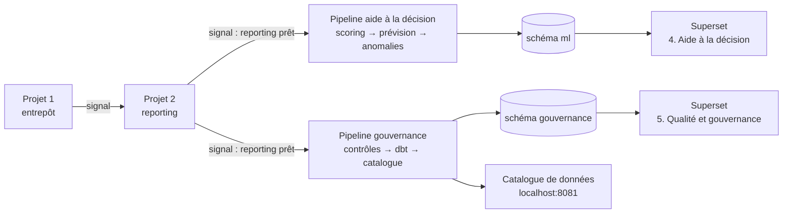

> 🔗 **Lumina Data Platform** : [1. Entrepôt](https://github.com/Isac9/lumina-data-platform-entrepot) · [2. Pilotage Superset](https://github.com/Isac9/lumina-data-platform-pilotage) · [3. Aide à la décision et gouvernance](https://github.com/Isac9/lumina-data-platform-aide-decision)

# Aide à la décision et gouvernance des données

> Projet portfolio de data engineering et data science : **scoring de risque** crédit, **prévision des encaissements** et **détection d'anomalies** en Python, orchestrés par Airflow ; plus un dispositif complet de **gouvernance** (historique de la qualité, fraîcheur, volumétrie, matrice des droits, classification, catalogue de données). Le tout est restitué dans Apache Superset.
> *Suite des projets 1 (entrepôt) et 2 (tableaux de bord). Lumina Énergie est une entreprise fictive : toutes les données sont générées.*

## Ce que fait le projet

| Brique | Méthode | Résultat |
|---|---|---|
| **Scoring de risque** | Régression logistique (champion) contre gradient boosting (challenger), validation **temporelle** | Probabilité qu'un prêt sain passe en PAR 30 à 3 mois, une classe A à E, et **les 3 raisons** de chaque note |
| **Prévision des encaissements** | Échéancier × taux de recouvrement, comparé à un modèle de série temporelle (ETS) avec intervalle de confiance | Prévision sur 3 mois par pays, avec un **backtest** (erreur moyenne mesurée) |
| **Détection d'anomalies** | Isolation Forest (agents), z-score (encaissements journaliers), rapprochement ERP | Une liste d'alertes à investiguer, avec une explication en clair |
| **Gouvernance** | dbt + catalogue PostgreSQL | Historique des contrôles qualité, fraîcheur des sources, volumétrie, matrice des droits, classification et données personnelles, dictionnaire des indicateurs |
| **Catalogue de données** | Documentation dbt des 3 projets | Tables, colonnes, tests et **lignage** de bout en bout |

## Architecture



## Résultats (données simulées)

- Score : **AUC 0,84, Gini 0,68**. Le modèle simple et explicable bat le modèle complexe (AUC 0,82). Le modèle est bien calibré.
- Prévision : erreur moyenne de **2 à 4 %** avec la méthode échéancier sur les 3 derniers mois testés.
- Qualité : 63 contrôles historisés, **98 %** de réussite. Le seul avertissement est le rapprochement ERP, voulu.

## Documents

- [Fiche du modèle de score](docs/fiche_modele_scoring.md)
- [Politique de gouvernance des données](docs/politique_gouvernance.md)

## Récupérer le code

Les projets 2 et 3 s'appuient sur les précédents : clone-les **côte à côte**, avec **exactement** ces noms de dossiers.

```bash
git clone https://github.com/Isac9/lumina-data-platform-entrepot.git projet1-entrepot-donnees
git clone https://github.com/Isac9/lumina-data-platform-pilotage.git projet2-tableaux-de-bord
git clone https://github.com/Isac9/lumina-data-platform-aide-decision.git projet3-aide-decision
```

## Démarrage

Les dossiers des 3 projets doivent être côte à côte.

```bash
cd projet3-aide-decision
docker compose up -d --build
```

| Service | Adresse | Identifiants |
|---|---|---|
| Superset (tableaux de bord 1 à 5) | http://localhost:8088 | admin / admin |
| Catalogue de données | http://localhost:8081 | (aucun) |
| Airflow | http://localhost:8080 | admin / admin |
